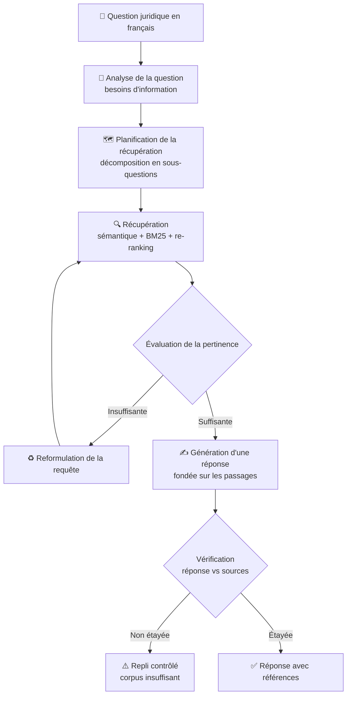

# ⚖️ Agentic RAG — Assistant juridique
### Composant francophone · Droit et réglementation marocains

---

> [!IMPORTANT]
> **Ce dépôt concerne le droit et la réglementation du Maroc rédigés en langue française.**
> Il ne s'agit pas d'un système dédié au droit national français.

> [!NOTE]
> Le projet est en **phase de cadrage**. Les capacités décrites ci-dessous sont des **objectifs**, sauf mention explicite dans la section [État d'avancement](#-état-davancement).

## 📑 Sommaire

1. [Vue d'ensemble](#-vue-densemble)
2. [Problématique](#-problématique)
3. [Objectifs](#-objectifs)
4. [Périmètre](#-périmètre-du-composant-francophone)
5. [Fonctionnalités prévues](#-fonctionnalités-prévues)
6. [Workflow Agentic RAG](#-workflow-agentic-rag-proposé)
7. [Principes de récupération et de génération](#-principes-de-récupération-et-de-génération)
8. [Citations et fiabilité](#-citations-et-fiabilité)
9. [État d'avancement](#-état-davancement)
10. [Relation avec le composant arabe](#-relation-avec-le-composant-arabe)
11. [Limites et évolutions](#-limites-et-évolutions)
12. [Contribuer](#-contribuer)

---

## 🔎 Vue d'ensemble

**Agentic RAG — Legal Assistant** vise à rendre l'information juridique et réglementaire plus facile à **rechercher, comprendre et analyser**.

Ce composant traite des documents juridiques marocains **en français** et permet d'interroger leur contenu en langage naturel.

Corpus visé :

- 📜 lois et textes juridiques marocains rédigés en français ;
- 🏛️ décrets et documents réglementaires ;
- 📰 publications et bulletins officiels ;
- 📂 autres documents juridiques publics en français.

## ❓ Problématique

Les textes juridiques sont volumineux, fragmentés entre de nombreuses sources et rédigés dans un vocabulaire spécialisé. Retrouver la disposition pertinente, vérifier sa source et en comprendre la portée demande du temps.

Un pipeline RAG classique (*retrieve, then generate*) ne suffit pas toujours en contexte juridique : une récupération imprécise peut produire une réponse non étayée. Ce projet explore une approche **agentique** qui évalue, corrige et vérifie ses propres étapes.

## 🎯 Objectifs

| # | Objectif |
|---|----------|
| 1 | Répondre à des questions en français naturel avec des réponses **structurées et fondées sur les sources** |
| 2 | Introduire un workflow agentique : analyse, planification, évaluation, correction, vérification |
| 3 | Privilégier la **traçabilité** et les preuves plutôt que des affirmations juridiques non étayées |
| 4 | Signaler explicitement lorsque le corpus disponible ne permet pas de répondre |

## 🧭 Périmètre du composant francophone

| ✅ Dans le périmètre | ❌ Hors périmètre |
|---|---|
| Documents juridiques marocains en français | Droit national français |
| Questions posées en français | Composant arabe (dépôt et équipe distincts) |
| Recherche, analyse et réponse sourcée | Conseil juridique professionnel |

## 🧩 Fonctionnalités prévues

> [!NOTE]
> Fonctionnalités **planifiées**. Aucune n'est présentée comme disponible à ce stade.

<b>📥 Ingestion de documents</b>

- Import de documents juridiques depuis des formats pris en charge.
- Extraction du texte avec conservation des métadonnées utiles.
- Conservation des références : nom du document, pages, source.
- Préparation du contenu pour l'indexation et la récupération.

<b>🔍 Récupération intelligente</b>

- Recherche sémantique par embeddings.
- Recherche lexicale par BM25.
- Récupération hybride combinant résultats sémantiques et lexicaux.
- Re-ranking des passages pour améliorer la pertinence.
- Filtrage par métadonnées lorsque cela est supporté.

<b>🤖 Workflow agentique</b>

- Orchestrateur chargé d'analyser la question et de planifier la récupération.
- Décomposition des questions complexes en sous-questions.
- Évaluation des passages récupérés et rejet des résultats non pertinents.
- Récupération corrective lorsque les premiers résultats sont insuffisants.
- Vérification des réponses générées par rapport aux preuves récupérées.
- Repli contrôlé lorsque le corpus ne permet pas de répondre.

<b>✍️ Génération de réponses</b>

- Réponses claires et structurées en français.
- Références aux documents juridiques à l'appui.
- Citations au niveau de la page ou du passage lorsque disponibles.
- Indicateur de confiance, s'il est implémenté.
- Mention explicite des preuves manquantes ou insuffisantes.

## 🔄 Workflow Agentic RAG (proposé)

> [!WARNING]
> Diagramme **conceptuel** décrivant le workflow **prévu**. Il ne reflète pas une implémentation existante.

Étapes prévues :

1. L'utilisateur soumet une question juridique en français.
2. Le système analyse la question et identifie ses besoins d'information.
3. L'agent décide de la stratégie de récupération.
4. La couche de récupération interroge le corpus juridique disponible.
5. Les passages sont évalués et filtrés selon leur pertinence.
6. Si les preuves sont insuffisantes, la requête peut être reformulée.
7. Le composant de génération produit une réponse structurée fondée sur les passages.
8. Une étape de vérification contrôle que la réponse est étayée par les sources.
9. L'utilisateur reçoit la réponse avec ses références, ou l'indication explicite que le corpus est insuffisant.

## 🧪 Principes de récupération et de génération

| Principe | Description |
|---|---|
| 📚 **Réponses fondées sur les sources** | Les réponses reposent sur les documents juridiques récupérés |
| 🧾 **Traçabilité** | Les documents et passages à l'appui d'une réponse sont identifiables |
| ✔️ **Vérification des preuves** | Les affirmations générées sont confrontées aux sources |
| ❔ **Incertitude contrôlée** | Le système signale l'information indisponible |
| 🛡️ **Réduction des hallucinations** | L'évaluation de la récupération et la vérification visent à limiter les affirmations non étayées |
| 🔓 **Transparence** | Les limites sont communiquées, sans présenter une information incertaine comme un fait juridique établi |

## 📌 Citations et fiabilité

- Chaque réponse doit pouvoir être rattachée à un ou plusieurs **documents sources**.
- Lorsque les métadonnées le permettent, les citations indiquent la **page** ou le **passage**.
- En l'absence de preuve suffisante, le système doit le **déclarer** plutôt que de répondre.

> [!CAUTION]
> Cet outil est un **outil de recherche d'information et d'assistance**. Il ne remplace **pas** un conseil juridique professionnel.

## 🚧 État d'avancement

> Légende : ✅ implémenté · 🛠️ en cours · 🗓️ planifié

| Composant | Statut |
|---|---|
| Cadrage du projet et gouvernance du dépôt | 🛠️ en cours |
| Ingestion de documents | 🗓️ planifié |
| Récupération hybride (sémantique + BM25) | 🗓️ planifié |
| Re-ranking | 🗓️ planifié |
| Orchestrateur agentique | 🗓️ planifié |
| Récupération corrective | 🗓️ planifié |
| Génération avec citations | 🗓️ planifié |
| Vérification des réponses | 🗓️ planifié |
| Évaluation et métriques | 🗓️ planifié |

> [!NOTE]
> Aucune pile technologique, aucun modèle, aucune base de données et aucun jeu de données n'est encore arrêté. Cette section sera mise à jour au fil de l'implémentation.

## 🌍 Relation avec le composant arabe

Le projet global comprend deux composants spécifiques à une langue :

| Composant | Responsable | Dépôt |
|---|---|---|
| RAG juridique **francophone** | Ce dépôt | Ce dépôt |
| RAG juridique **arabophone** | Autre équipe | Dépôt séparé |

Les deux composants sont développés **indépendamment**. Aucune intégration n'est aujourd'hui revendiquée.

## ⚠️ Limites et évolutions

**Limites actuelles**

- Projet en phase de cadrage : aucune fonctionnalité n'est opérationnelle.
- La qualité des réponses dépendra de la couverture et de la qualité du corpus.
- Aucune métrique de performance n'est disponible.

**Évolutions envisagées**

- Définition du corpus et des formats d'entrée.
- Choix argumentés de la pile technique.
- Mise en place d'un protocole d'évaluation (pertinence de la récupération, fidélité aux sources).
- Étude d'une intégration future avec le composant arabe.

## 🤝 Contribuer

Le dépôt applique une stratégie de branches protégée :

| Branche | Rôle |
|---|---|
| `production` | Branche principale, protégée |
| `<Nom>` | Branche personnelle de chaque contributeur |

Consultez [CONTRIBUTING.md](CONTRIBUTING.md) pour le processus détaillé.

**Responsable du dépôt :** [@usrchoabderrahim](https://github.com/usrchoabderrahim)

---

⚖️ Outil d'aide à la recherche d'information juridique — ne constitue pas un conseil juridique.

