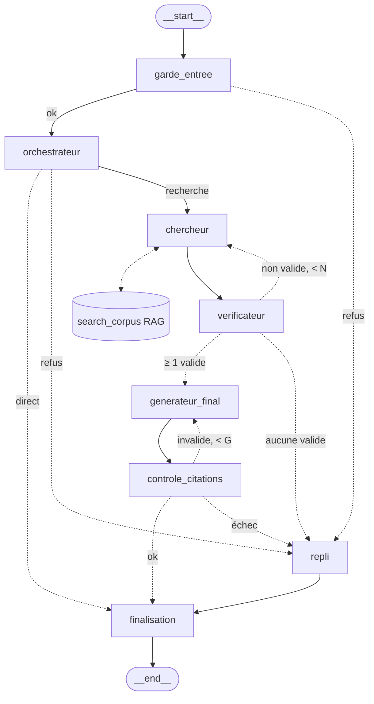

# Workflow Agentic RAG — architecture (8 nœuds)

Implémentation de la spécification `task_rag_fr.docx`. Code : `src/agent/`.



| # | Nœud | Type | Fichier | Contribution |
|---|------|------|---------|--------------|
| 1 | garde_entree | déterministe | `nodes/garde_entree.py` | Chokri |
| 2 | orchestrateur | agent LLM | `nodes/orchestrateur.py` | Chokri |
| 3 | chercheur | agent LLM + outil | `nodes/chercheur.py`, `tools.py` | Youssef |
| 4 | verificateur | agent LLM + code | `nodes/verificateur.py` | Youssef |
| 5 | generateur_final | agent LLM | `nodes/generateur_final.py` | Mouaad |
| 6 | controle_citations | déterministe | `nodes/controle_citations.py` | Mouaad |
| 7 | repli | déterministe | `nodes/repli.py` | Chokri |
| 8 | finalisation | déterministe | `nodes/finalisation.py` | Chokri |

Socle commun (Chokri) : `config.py` (seuils), `state.py` (état), `llm.py` (backends LLM,
appel JSON, budget), `text.py` (normalisation), `graph.py` (arêtes et moteur).
Les nœuds 3 à 6 sont chargés à la demande par `graph.py` : tant qu'une contribution n'est
pas fusionnée, une requête de recherche part en repli (cause `noeud_indisponible` dans la trace).

## Règles implémentées

| Règle de la spécification | Où |
|---|---|
| Rôle absent → rejet (T-14) ; rôle ∈ {admin, reader} | `garde_entree.check_input` |
| Question vide / > 2000 caractères / injection de prompt → refus | `garde_entree`, `config.INJECTION_PATTERNS` |
| Orchestrateur appelé une fois ; JSON invalide → 1 nouvel essai → route recherche avec la question brute | `orchestrateur.make_orchestrateur` |
| 1 à 4 sous-questions ; `direct` sans réponse exploitable → recherche | `orchestrateur.normalize` |
| 1 à 3 requêtes ; jamais une requête déjà essayée (contrôle par code) | `chercheur.new_queries` |
| `user_role` ajouté par le wrapper, invisible et non modifiable par le LLM | `tools.SearchTool.call` |
| Liste blanche d'outils, limite d'appels par tentative, timeout | `tools.ALLOWED_TOOLS`, `config.MAX_TOOL_CALLS_PER_ATTEMPT`, `config.TOOL_TIMEOUT_SECONDS` |
| Filtre exact si un article précis est cité | `chercheur.article_filter` |
| Passages déjà rejetés écartés | `chercheur` (`rejected_chunk_ids` cumulés) |
| Chiffres, dates, numéros d'articles présents dans le passage cité | `verificateur.code_check` |
| valid = supported_ratio ≥ 0,8 et relevance ≥ 0,6 (le code décide) | `verificateur.decide` |
| confidence = 0,5 × supported_ratio + 0,5 × relevance | `verificateur.decide` |
| Statut valide / en_cours (< N) / insuffisant | `verificateur` |
| Passages numérotés [1], [2]… par le code | `generateur_final.number_passages` |
| « Ce que je n'ai pas trouvé : … » pour une sous-question insuffisante | `generateur_final` (garanti par code) |
| 4 contrôles de citations | `controle_citations.check_citations` |
| Message de repli unique ; cause dans la trace seulement (F-SEC-05) | `repli` |
| Statut reponse / partielle / repli conservé | `finalisation` |
| Confiance globale = moyenne des confidence validées × part validée ; None si direct | `finalisation.global_confidence` |
| Avertissement « réponse générée, vérifiez les sources » ; latence et tokens dans la trace | `finalisation` |

## Valeurs non fixées par la spécification

| Paramètre | Valeur | Constante |
|---|---|---|
| N (tentatives de recherche par sous-question) | 3 | `MAX_RESEARCH_ATTEMPTS` |
| G (générations : 1 + 1 régénération) | 2 | `MAX_GENERATION_ATTEMPTS` |
| Budget global par requête | 40 appels LLM, 300 s | `MAX_LLM_CALLS`, `MAX_LATENCY_SECONDS` |
| top_k | 5 | `TOP_K` |

L'avertissement est ajouté aux réponses générées (`reponse`, `partielle`, y compris directes),
pas au message de repli. Une réponse directe a le statut `reponse` et une confiance `None`.

## LLM

Tous les backends sont gratuits :

| `RAG_LLM` | Backend | Réglages |
|---|---|---|
| `ollama` | LLM local Ollama | `OLLAMA_MODEL` (défaut `qwen2.5:7b`), `OLLAMA_URL` |
| `openrouter` | API OpenRouter, modèles `:free` | `OPENROUTER_API_KEY` (variable d'environnement, jamais committée), `OPENROUTER_MODEL` (liste séparée par des virgules ; si un modèle gratuit est saturé, le suivant est essayé) |
| `heuristic` | moteur hors-ligne déterministe | — |
| `auto` (défaut) | Ollama s'il répond, sinon OpenRouter si la clé existe, sinon heuristic | — |

Si le LLM devient injoignable (limite de débit gratuite, réseau), la requête part en repli
(cause `llm_indisponible` dans la trace). Chaque nœud enregistre son heuristique
(`@register_heuristic`) : réponses extractives à partir des passages réels, utiles pour
les démonstrations et les tests, sans prétendre égaler un vrai LLM.

## Recherche

`tools.build_search_tool()` réutilise `src/retrieval` (`Retriever`, BM25, fusion RRF) :
mode `hybrid` (bge-m3 + BM25) si `sentence-transformers` est installé, sinon `bm25`
(`RAG_SEARCH_MODE=bm25` pour le forcer). Les vecteurs précalculés sont cherchés en mémoire
(`NumpyVectorStore`, exact) ; `RAG_VECTOR_STORE=chroma` utilise `ChromaStore`. Les deux corpus
(`fstbm`, `ocr`) sont interrogés puis fusionnés par RRF.

Données attendues (non versionnées) : `data/embeddings/embeddings_fstbm/` et
`data/embeddings/embeddings_ocr/` (`all_chunks.jsonl`, `embeddings.npy`, `embedding_ids.jsonl`).

## Tests

```powershell
python -m pytest tests/agent -q
```

Les tests qui lisent les corpus réels sont ignorés si `data/embeddings` est absent.
